# Lab 6 — UAT results: Worawut

| Case ID | AC | Tester | Date/time (timezone) | App URL | Revision / source commit | Result (`PASS` / `FAIL` / `BLOCKED`) | Evidence ID | Finding / notes |
|---|---|---|---|---|---|---|---|---|
| UAT-01 | FR-01, FR-04, FR-05, FR-06, FR-07, FR-08; AC-F01-14, AC-F03-15, AC-F03-20, AC-F04-13, AC-F04-18, AC-F04-20 | Worawut | 2026-11-23 22:58–22:59; evidence retest 2026-11-24 02:55–02:59 (Asia/Bangkok) | https://approval-flow-rdaxzekvca-as.a.run.app/ | approval-flow-00004-rq6 / 21b7135 (`v1.1.0-lab5`) | PASS | [E-UAT-01-01](evidence/E-UAT-01-01-request-submitted.png), [E-UAT-01-02](evidence/E-UAT-01-02-review-inbox.png), [E-UAT-01-03](evidence/E-UAT-01-03-reviewer-approved.png), [E-UAT-01-04](evidence/E-UAT-01-04-requester-approved-detail.png), [E-UAT-01-05](evidence/E-UAT-01-05-review-inbox-after-approval.png); E-UAT-01-06–08 pending; [E-UAT-01-SUPP-01](evidence/E-UAT-01-SUPP-01-REQ-000017-approved-detail.png), [E-UAT-01-SUPP-02](evidence/E-UAT-01-SUPP-02-REQ-000017-inbox-after-approval.png) | Original run used `REQ-000017`; the new screenshots show a second run with `REQ-000036`, Ploy → Mint, THB 1,250.50, approved with “Within budget.” The inbox screenshots do not show `REQ-000036` in the captured viewport. Build 21b7135 shown. |
| UAT-02 | FR-09; BR-12, BR-13; AC-F04-05, AC-F04-13 | Worawut | 2026-11-23 23:10–23:12; evidence retest 2026-11-24 02:49–02:51 (Asia/Bangkok) | https://approval-flow-rdaxzekvca-as.a.run.app/ | approval-flow-00004-rq6 / 21b7135 (`v1.1.0-lab5`) | PASS | [E-UAT-02-01](evidence/E-UAT-02-01-request-submitted.png), [E-UAT-02-02](evidence/E-UAT-02-02-reviewer-decision-panel.png), [E-UAT-02-03](evidence/E-UAT-02-03-reviewer-rejected.png), [E-UAT-02-04](evidence/E-UAT-02-04-requester-rejected-detail.png); [E-UAT-02-SUPP-01](evidence/E-UAT-02-SUPP-01-REQ-000019-rejected-detail.png) | Original run used `REQ-000019`; the new screenshots show a second run with `REQ-000035`, same UAT-02 title, THB 8,000, Ploy → Mint. Mint rejected with “Please get a second quotation.” Ploy's view showed Rejected and Submitted → Rejected history. Build 21b7135 shown throughout. |
| UAT-03 | BR-04; AC-F03-05, AC-F03-16 | Worawut | 2026-11-23 23:12–23:14; evidence retest 2026-11-24 ~03:11 (Asia/Bangkok) | https://approval-flow-rdaxzekvca-as.a.run.app/ | approval-flow-00004-rq6 / 21b7135 (`v1.1.0-lab5`) | PASS | [E-UAT-03-01](evidence/E-UAT-03-01-blank-amount.png), [E-UAT-03-02](evidence/E-UAT-03-02-nonnumeric-amount.png), [E-UAT-03-03](evidence/E-UAT-03-03-excess-decimal-places.png), [E-UAT-03-04](evidence/E-UAT-03-04-zero-amount.png), [E-UAT-03-05](evidence/E-UAT-03-05-above-maximum.png), [E-UAT-03-06](evidence/E-UAT-03-06-minimum-accepted.png), [E-UAT-03-07](evidence/E-UAT-03-07-maximum-accepted.png) | Original run created `REQ-000020` (`0.01`) and `REQ-000021` (`1,000,000.00`). New screenshots show the five expected invalid amount messages and accepted boundaries `REQ-000037` (`0.01`) and `REQ-000038` (`1,000,000.00`). Build 21b7135 shown. |
| UAT-04 | BR-12; AC-F04-06, AC-F04-17 | Worawut | 2026-11-23 23:14–23:19; evidence retest 2026-11-24 03:14–03:19 (Asia/Bangkok) | https://approval-flow-rdaxzekvca-as.a.run.app/ | approval-flow-00004-rq6 / 21b7135 (`v1.1.0-lab5`) | PASS | [E-UAT-04-01](evidence/E-UAT-04-01-REQ-000039-empty-reason-validation.png), [E-UAT-04-02](evidence/E-UAT-04-02-REQ-000039-whitespace-only-validation.png), [E-UAT-04-03](evidence/E-UAT-04-03-REQ-000039-approved-detail.png) | Original run used `REQ-000022`; the retest screenshots show `REQ-000039` (THB 10,000, Ploy → Mint). The first validation capture corresponds to a blank reason; the second corresponds to the whitespace-only step in the supplied sequence, though entered spaces are not visible in the screenshot. Both show the required-reason validation message. Ploy's final detail shows Approved and Submitted → Approved history. Build 21b7135 was shown in the original run; the retest screenshots do not include the build footer. |
| UAT-05 | BR-05; AC-F03-06, AC-F03-21 | Worawut | 2026-11-23 23:20–23:21; evidence retest 2026-11-24 04:07–04:08 (Asia/Bangkok) | https://approval-flow-rdaxzekvca-as.a.run.app/ | approval-flow-00004-rq6 / 21b7135 (`v1.1.0-lab5`) | PASS | [E-UAT-05-01](evidence/E-UAT-05-01-required-fields-empty.png), [E-UAT-05-02](evidence/E-UAT-05-02-title-over-limit.png), [E-UAT-05-03](evidence/E-UAT-05-03-long-title-accepted.png), [E-UAT-05-04](evidence/E-UAT-05-04-html-strings-literal.png) | Original run verified blank required fields, title-length rejection, acceptance of a 120-character title with a 2,000-character description as `REQ-000023`, and literal rendering of `` / `` as `REQ-000024`. New screenshots show required-field errors, title over-limit validation, a long-title request accepted as `REQ-000043` (description `limit`), and the HTML strings displayed literally in `REQ-000044`. The retest captures do not show the 2,000-character description or Build footer. |
| UAT-06 | BR-01, BR-09, FR-10; AC-F02-01, AC-F02-03, AC-F02-11, AC-F02-12 | Worawut | 2026-11-23 23:23–23:26; status retest before 23:59; evidence screenshots supplied 2026-11-24 (Asia/Bangkok; screenshot times not visible) | https://approval-flow-rdaxzekvca-as.a.run.app/ | approval-flow-00004-rq6 / 21b7135 (`v1.1.0-lab5`) | PASS | [E-UAT-06-01](evidence/E-UAT-06-01-denied-reviews-page.png), [E-UAT-06-02](evidence/E-UAT-06-02-review-inbox-empty.png), [E-UAT-06-03](evidence/E-UAT-06-03-signed-in-reviews-forbidden.png), [E-UAT-06-04](evidence/E-UAT-06-04-signed-out-sign-in-page.png), [E-UAT-06-05](evidence/E-UAT-06-05-signed-out-reviews-unauthenticated.png), [E-UAT-06-06](evidence/E-UAT-06-06-signed-out-requests-unauthenticated.png), [E-UAT-06-07](evidence/E-UAT-06-07-ploy-requester-menu.png), [E-UAT-06-08](evidence/E-UAT-06-08-ploy-reviews-denied.png), [E-UAT-06-09](evidence/E-UAT-06-09-ploy-reviews-forbidden-body.png), [E-UAT-06-10](evidence/E-UAT-06-10-signed-out-requests-401.png), [E-UAT-06-11](evidence/E-UAT-06-11-signed-out-inbox-401.png) | [E-UAT-06-07](evidence/E-UAT-06-07-ploy-requester-menu.png) confirms Ploy is signed in as Requester and Review Inbox is absent from the menu; [E-UAT-06-08](evidence/E-UAT-06-08-ploy-reviews-denied.png) confirms direct `/reviews` denial with Ploy's identity visible. shows signed-in `GET /api/reviews/inbox` returning HTTP 403 and `FORBIDDEN`, with no request data. After logout, [E-UAT-06-10](evidence/E-UAT-06-10-signed-out-requests-401.png) shows `/api/requests/mine` returning HTTP 401 and `UNAUTHENTICATED`; [E-UAT-06-11](evidence/E-UAT-06-11-signed-out-inbox-401.png) shows the same for `/api/reviews/inbox`. The 403 capture has the session-cookie value redacted. Build 21b7135 is visible on E-UAT-06-08; the API captures have no app footer. |
| UAT-07 | BR-08, BR-09, NFR-02; AC-F03-11, AC-F03-13, AC-F04-09 | Worawut | 2026-11-23 (before 23:52:24; exact minute not captured); evidence screenshots supplied 2026-11-24 (times not visible, Asia/Bangkok) | https://approval-flow-rdaxzekvca-as.a.run.app/ | approval-flow-00004-rq6 / 21b7135 (`v1.1.0-lab5`) | PASS | [E-UAT-07-01](evidence/E-UAT-07-01-requester-unavailable-page.png), [E-UAT-07-02](evidence/E-UAT-07-02-requester-not-found-body.png), [E-UAT-07-03](evidence/E-UAT-07-03-reviewer-unavailable-page.png), [E-UAT-07-04](evidence/E-UAT-07-04-reviewer-not-found-body.png) | Original run passed for `REQ-000025`: REQ-B and REV-B were denied, both API responses were `NOT_FOUND` with HTTP 404, and assigned reviewer Mint saw the decision panel. New screenshots show unavailable pages and `NOT_FOUND` bodies, but do not show the request ID or API status. The reviewer page names Mint Chaiyaporn and shows access denied, which conflicts with the original assigned-reviewer observation; without the request ID, it cannot be confirmed that this is `REQ-000025`. PASS reflects the original run; the new screenshots are supplemental and need request/account mapping. |
| UAT-08 | BR-06, BR-10; AC-F03-08, AC-F03-10, AC-F04-16, AC-F04-23 | Worawut | 2026-11-23 (before 23:52:24; exact minute not captured); evidence retest 2026-11-24 04:35 (Asia/Bangkok) | https://approval-flow-rdaxzekvca-as.a.run.app/ | approval-flow-00004-rq6 / 21b7135 (`v1.1.0-lab5`) | PASS | [E-UAT-08-01](evidence/E-UAT-08-01-reviewer-dropdown-korn-only.png), [E-UAT-08-02](evidence/E-UAT-08-02-REQ-000045-submitted.png), [E-UAT-08-03](evidence/E-UAT-08-03-mint-inbox-empty.png), [E-UAT-08-04](evidence/E-UAT-08-04-mint-no-decision-controls.png); [E-UAT-08-SUPP-01](evidence/E-UAT-08-SUPP-01-REQ-000013-korn-review-panel.png) | Original run used `REQ-000026`; the new screenshots show Mint's reviewer dropdown offering Korn only, Mint submitting `REQ-000045` (THB 500) to Korn, no requests in Mint's Review Inbox, and no decision panel on Mint's detail page. The supplemental screenshot shows Korn's decision panel for earlier `REQ-000013`, titled `UAT-08 TH019 2026-11-23`. Build 21b7135 was visible in the original run; the retest screenshots do not show the footer. |
| UAT-09 | BR-11, BR-13, BR-15, FR-06; AC-F03-20, AC-F04-13, AC-F04-16, AC-F04-20 | Worawut | 2026-11-23 (before 23:52:24; exact minute not captured); screenshots supplied 2026-11-24 (Asia/Bangkok; app timestamps 04:48–04:49, exact capture time not shown) | https://approval-flow-rdaxzekvca-as.a.run.app/ | approval-flow-00004-rq6 / 21b7135 (`v1.1.0-lab5`) | PASS | [E-UAT-09-01](evidence/E-UAT-09-01-REQ-000046-rejected-detail.png), [E-UAT-09-02](evidence/E-UAT-09-02-REQ-000046-rejected-detail-repeat.png), [E-UAT-09-03](evidence/E-UAT-09-03-mint-inbox-empty-after-rejection.png); E-UAT-09-04 pending | Original run used `REQ-000029`, rejected by Mint with `Not in this quarter's budget.`. New screenshots show Ploy's `REQ-000046` (THB 10,000) as Rejected by Mint with reason `Bad`, and Submitted → Rejected history. The two detail captures show the same final state; Mint's inbox screenshot says no requests are waiting, but does not show a request ID. No edit/delete controls are visible on the requester detail. Build 21b7135 was visible in the original run; the retest screenshots do not show the footer. |
| UAT-10 | AC-F04-11, AC-F04-19 | Worawut | 2026-11-23 ~23:49 (Asia/Bangkok; approximate); screenshots supplied 2026-11-24 (app timestamps 04:59–05:01, exact capture time not shown) | https://approval-flow-rdaxzekvca-as.a.run.app/ | approval-flow-00004-rq6 / 21b7135 (`v1.1.0-lab5`) | PASS | [E-UAT-10-01](evidence/E-UAT-10-01-REQ-000047-two-tabs-submitted.png), [E-UAT-10-02](evidence/E-UAT-10-02-first-tab-approved.png), [E-UAT-10-03](evidence/E-UAT-10-03-stale-tab-already-decided.png), [E-UAT-10-04](evidence/E-UAT-10-04-stale-tab-refreshed.png), [E-UAT-10-05](evidence/E-UAT-10-05-requester-approved-detail.png) | Original run used `REQ-000030`. New screenshots show `REQ-000047` (THB 6,700) open in two Mint tabs; the first tab approved it at 05:01 with `LGTM. Approved`. Rejecting from the stale second tab showed `This request has already been decided.`; after refresh, it showed Approved with the original reason and only one decision in history. Ploy's detail confirms the same final state. Build 21b7135 is visible. |
| UAT-11 | FR-01, FR-02, FR-03, NFR-06; AC-F01-02, AC-F01-03, AC-F01-04, AC-F01-14, AC-F01-15, AC-F01-17, AC-F01-18 | Worawut | 2026-11-23 (before 23:52:24; exact minute not captured); 2026-11-24 00:38 (Asia/Bangkok); screenshots supplied 2026-11-24 (capture times not visible) | https://approval-flow-rdaxzekvca-as.a.run.app/ | approval-flow-00004-rq6 / 21b7135 (`v1.1.0-lab5`) | PASS | [E-UAT-11-01](evidence/E-UAT-11-01-empty-sign-in-validation.png), [E-UAT-11-02](evidence/E-UAT-11-02-case-variant-credentials-entered.png), [E-UAT-11-03](evidence/E-UAT-11-03-known-account-generic-error.png), [E-UAT-11-04](evidence/E-UAT-11-04-unknown-account-generic-error.png), [E-UAT-11-05](evidence/E-UAT-11-05-mint-review-inbox.png), [E-UAT-11-06](evidence/E-UAT-11-06-case-variant-sign-in-success.png) | Empty sign-in screenshots show both required-field messages; the focus indicator was observed but its screenshot was omitted because a saved-account autofill prompt was visible. The case-variant entry screenshot followed by a supplied My Requests screenshot shows Ploy signed in, supporting successful sign-in with `PLOY.Requester@Example.COM`; these screenshots do not show trailing whitespace or a reload. The initial run separately observed `PLOY.Requester@Example.COM ` sign in as Ploy and persist after reload. New screenshots show the same generic error for known and unknown accounts and Mint signed in to an empty Review Inbox. Sign-out followed by `/requests` showed Login in the prior run. Build 21b7135 was visible in the original run; the new screenshots do not show the footer. |
| UAT-12 | NFR-05; AC-F01-07, AC-F01-16 | Worawut | 2026-11-23 23:59–2026-11-24 00:01 (Asia/Bangkok; crossed midnight); screenshots supplied 2026-11-24 (capture times not visible) | https://approval-flow-rdaxzekvca-as.a.run.app/ | approval-flow-00004-rq6 / 21b7135 (`v1.1.0-lab5`) | PASS | [E-UAT-12-01](evidence/E-UAT-12-01-ploy-throttled-12-minutes.png), [E-UAT-12-02](evidence/E-UAT-12-02-ploy-throttled-11-minutes.png), [E-UAT-12-03](evidence/E-UAT-12-03-nattapong-my-requests.png) | Original run: REQ-B's first five wrong-password attempts showed `Email or password is incorrect.`; attempt six showed `Too many sign-in attempts. Try again in 15 minutes.`; the correct REQ-B password remained throttled, then Ploy signed in. New screenshots show Ploy's account with 12 minutes, then 11 minutes, remaining in the lockout, and a separate Nattapong requester session on My Requests. They are consistent with another account remaining usable during Ploy's lockout, but do not show the exact timing of Nattapong's sign-in relative to the countdown. Build 21b7135 was visible in the original run; the new screenshots do not show the footer. |

Execution summary: 12 PASS and 0 BLOCKED. No confirmed product defect was observed. UAT-12 ran last and crossed midnight into 2026-11-24 (Asia/Bangkok). Codex performed the original browser tests at Worawut's request; Worawut supplied additional screenshots for UAT-01 through UAT-12, including supplemental screenshots for UAT-01, UAT-02, and UAT-08. Participation by both named students was not independently observed.

## UAT-01 notes

- **Test data:** Both runs used title `UAT-01 WS 2026-11-23`, description `Two monitors for the lab`, amount THB 1,250.50, requester REQ-A Ploy, reviewer REV-A Mint, and approval reason `Within budget`. Original request: `REQ-000017`; screenshot retest request: `REQ-000036`.
- **Observed:** In the original run, Ploy submitted `REQ-000017`; Mint approved it. Ploy's re-opened detail showed Approved, Mint, the reason, and Submitted → Approved history after sign-in and reload. The new screenshots show Ploy's submission of `REQ-000036` at 02:55, Mint's approval at 02:59, and Ploy's approved detail with the same reason and history.
- **Build:** Build 21b7135 is visible in all five new screenshots.
- **Evidence:** The five new screenshots are [E-UAT-01-01](evidence/E-UAT-01-01-request-submitted.png), [E-UAT-01-02](evidence/E-UAT-01-02-review-inbox.png), [E-UAT-01-03](evidence/E-UAT-01-03-reviewer-approved.png), [E-UAT-01-04](evidence/E-UAT-01-04-requester-approved-detail.png), and [E-UAT-01-05](evidence/E-UAT-01-05-review-inbox-after-approval.png). E-UAT-01-02 and 05 show Mint's inbox, but `REQ-000036` is not visible in either captured viewport; they do not by themselves prove that this request appeared before approval or was removed afterward. E-UAT-01-06–08 remain pending. Earlier `REQ-000017` screenshots are preserved as E-UAT-01-SUPP-01–02.

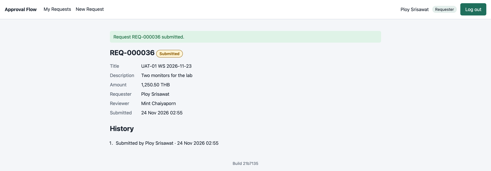

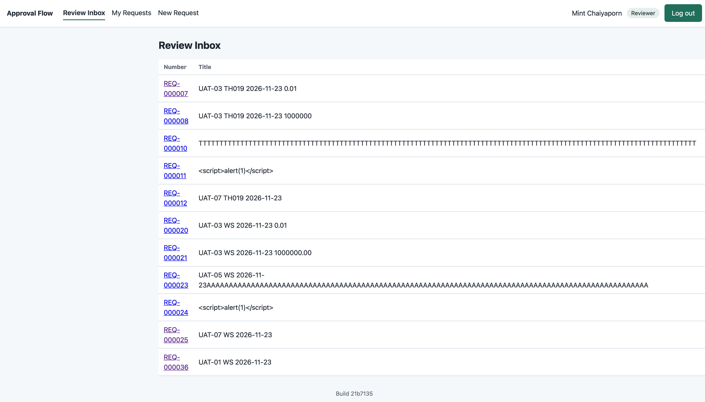

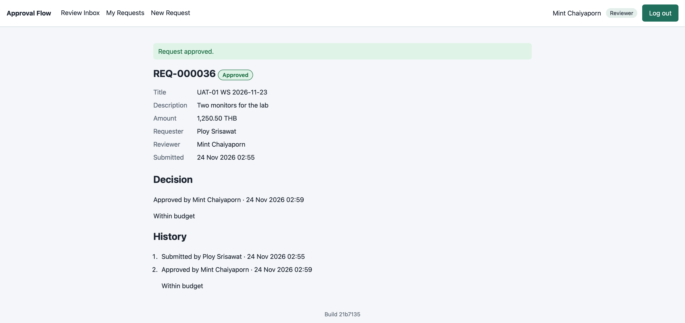

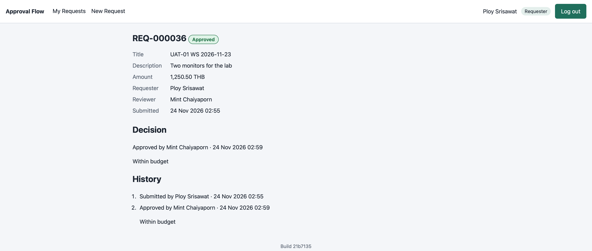

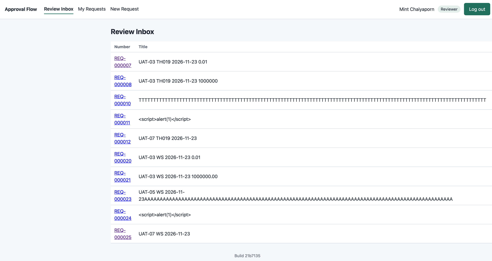

- **Attribution:** The original UAT actions were performed by Codex at Worawut's request. The five additional REQ-000036 screenshots were supplied by Worawut. Neither set independently establishes participation by both students required by the handout.

## UAT-03 notes

- **Inputs and observed validation:** blank → `Enter an amount.`; `abc` and `12.345` → `Enter the amount as a number, for example 1250.50.`; `0` → `Enter an amount greater than 0.`; `1000000.01` → `Enter an amount of at most 1,000,000.00 THB.` No request was created for these invalid values.
- **Accepted boundaries:** The original run created `REQ-000020` (`0.01`) and `REQ-000021` (`1000000.00`). The evidence retest created `REQ-000037` (`0.01`) and `REQ-000038` (`1000000.00`); both screenshots show Ploy, Mint as reviewer, and status Submitted.
- **Build:** Build 21b7135 is visible in all seven new screenshots.
- **Evidence:** The seven screenshots cover the blank, nonnumeric, excess-decimal, zero, and over-limit validations, then the accepted minimum and maximum. See [E-UAT-03-01](evidence/E-UAT-03-01-blank-amount.png) through [E-UAT-03-07](evidence/E-UAT-03-07-maximum-accepted.png).

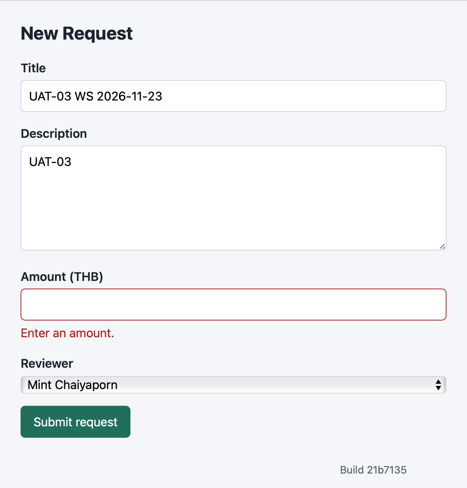

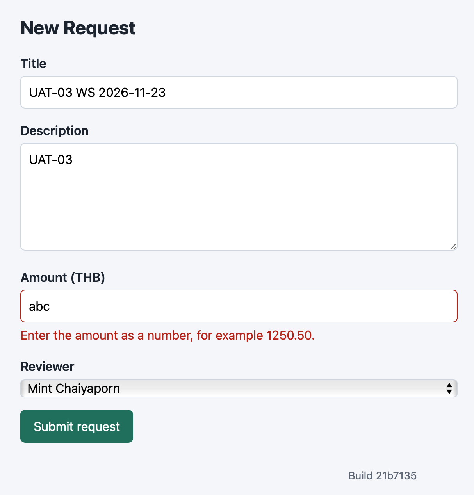

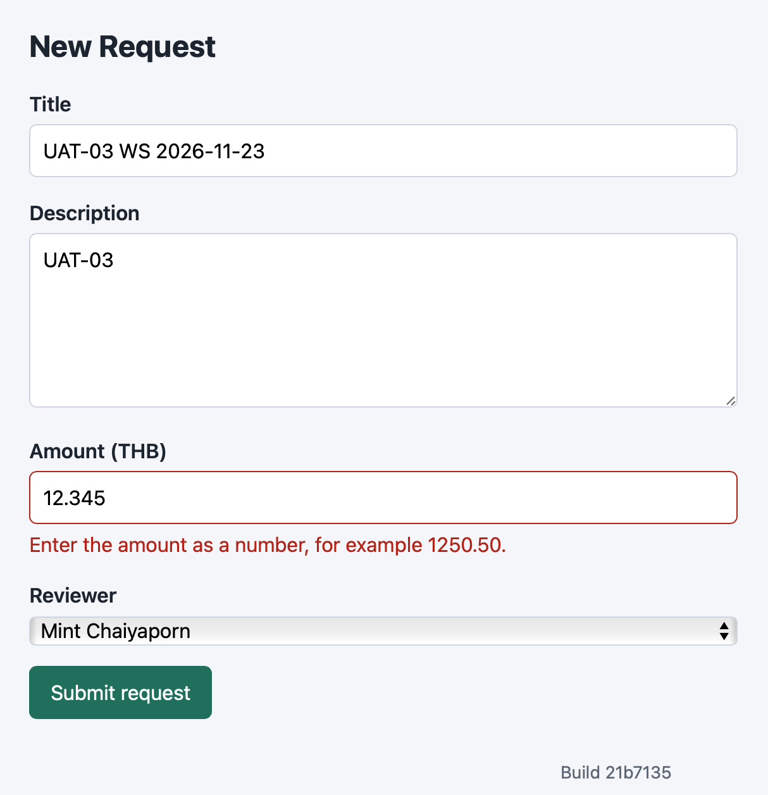

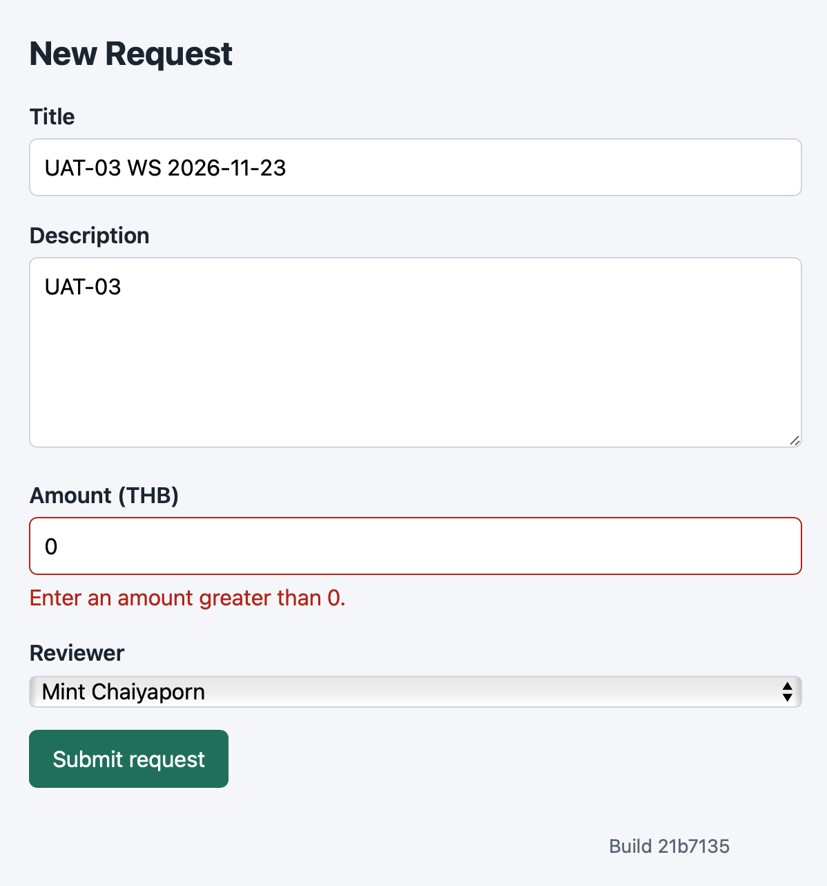

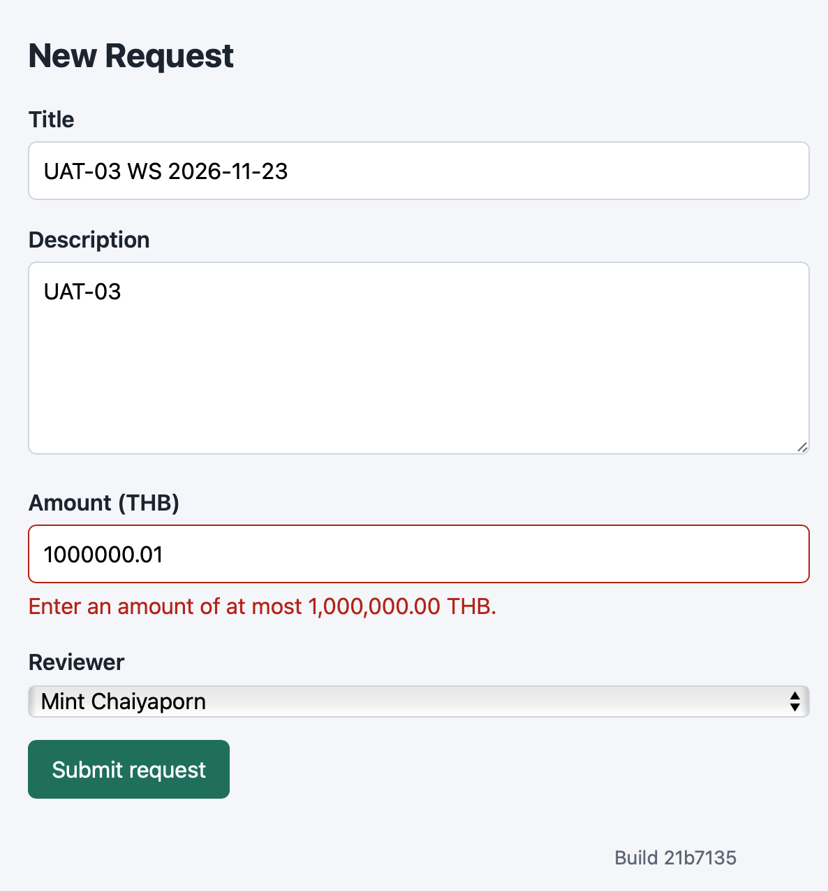

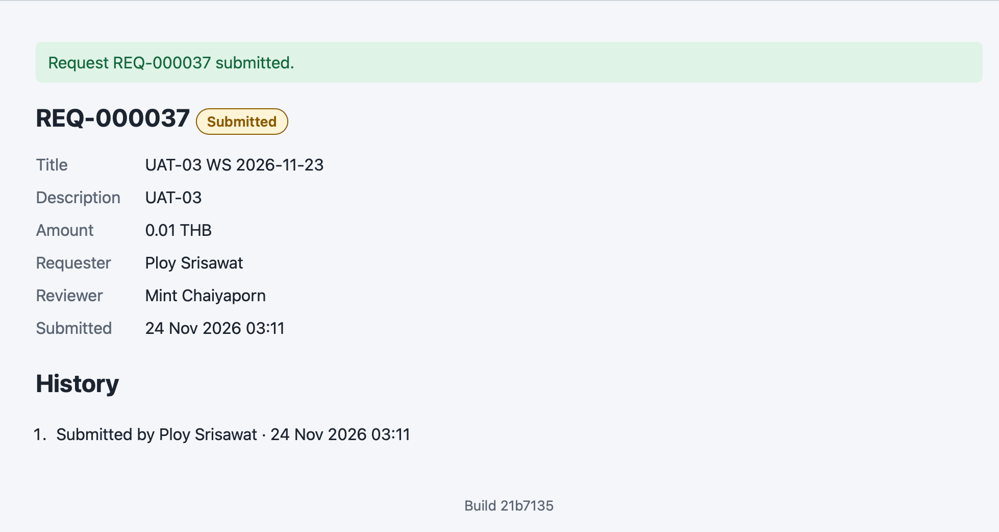

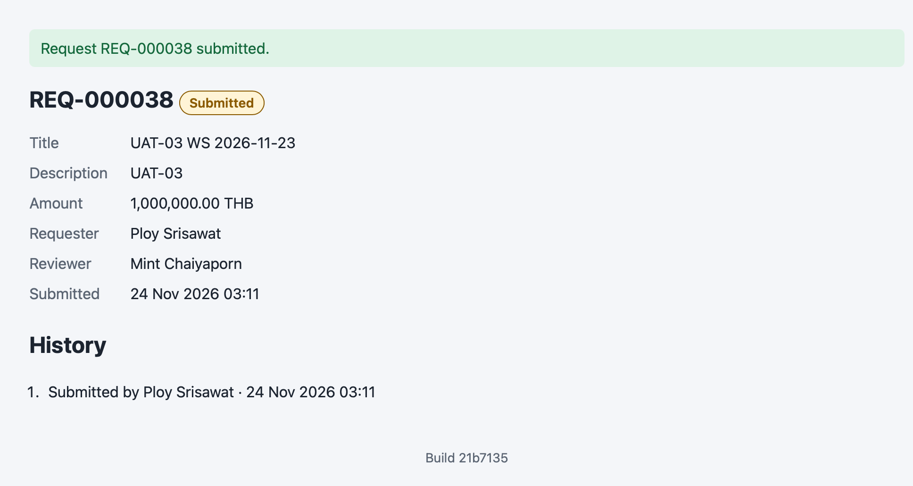

- **Attribution:** The original UAT actions were performed by Codex at Worawut's request. The seven additional UAT-03 screenshots were supplied by Worawut. Neither set independently establishes participation by both students required by the handout.

## UAT-02 notes

- **Test data:** Both runs used title `UAT-02 WS 2026-11-23`, description `Standing desk`, amount THB 8,000, requester REQ-A Ploy, reviewer REV-A Mint, and rejection reason `Please get a second quotation.`. Original request: `REQ-000019`; evidence retest request: `REQ-000035`.
- **Observed:** In the original run, Ploy submitted `REQ-000019`; Mint rejected it. In the evidence retest on 2026-11-24 02:49–02:51, Ploy submitted `REQ-000035`, Mint saw the Submitted request and decision panel, rejected it, and Ploy's detail showed Rejected, the exact reason, and Submitted → Rejected history.
- **Build:** 21b7135 was visible in the submitted/detail, reviewer, rejection-confirmation, and requester detail screenshots.
- **Evidence:** The four new screenshots cover the flow: [E-UAT-02-01](evidence/E-UAT-02-01-request-submitted.png), [E-UAT-02-02](evidence/E-UAT-02-02-reviewer-decision-panel.png), [E-UAT-02-03](evidence/E-UAT-02-03-reviewer-rejected.png), and [E-UAT-02-04](evidence/E-UAT-02-04-requester-rejected-detail.png). [E-UAT-02-SUPP-01](evidence/E-UAT-02-SUPP-01-REQ-000019-rejected-detail.png) preserves the earlier REQ-000019 final detail.

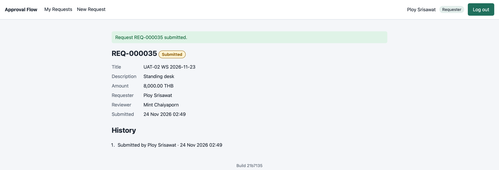

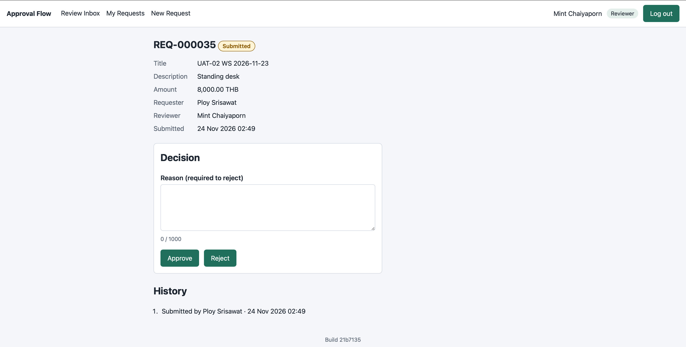

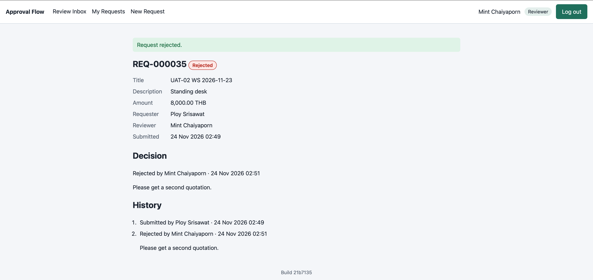

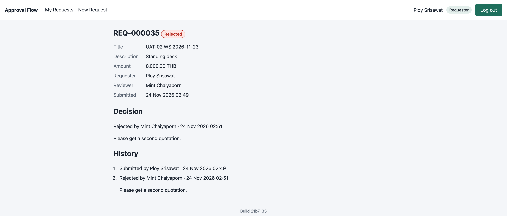

- **Attribution:** The original UAT actions were performed by Codex at Worawut's request. The four additional REQ-000035 screenshots were supplied by Worawut. Neither set independently establishes participation by both students required by the handout.

## UAT-04 notes

- **Test data:** The original run used `UAT-04 WS 2026-11-23`, amount `1200`, and `REQ-000022`. The screenshot retest used title and description `UAT-04 WS 2026-11-24`, amount THB 10,000, requester Ploy, reviewer Mint, and `REQ-000039`.
- **Observed:** In the original run, blank and whitespace-only (`   `) rejection attempts showed `Enter a reason to reject this request.`; after reloading Review Inbox, the request was still listed as undecided. Approving with a blank reason succeeded. Ploy's re-login showed Approved and Submitted → Approved history. The new screenshots for `REQ-000039` show the required-reason error for the blank and whitespace-only steps, followed by its Approved detail and Submitted → Approved history. The second screenshot is assigned to the whitespace-only step by its position in the supplied sequence; entered spaces are not visible in the field.
- **Build:** Build 21b7135 was visible in the original run. The supplied retest screenshots are cropped and do not show the build footer.
- **Evidence:** [E-UAT-04-01](evidence/E-UAT-04-01-REQ-000039-empty-reason-validation.png) shows the blank-reason validation; [E-UAT-04-02](evidence/E-UAT-04-02-REQ-000039-whitespace-only-validation.png) is the whitespace-only step in the supplied sequence (spaces are not visible); [E-UAT-04-03](evidence/E-UAT-04-03-REQ-000039-approved-detail.png) shows the approved result and history.

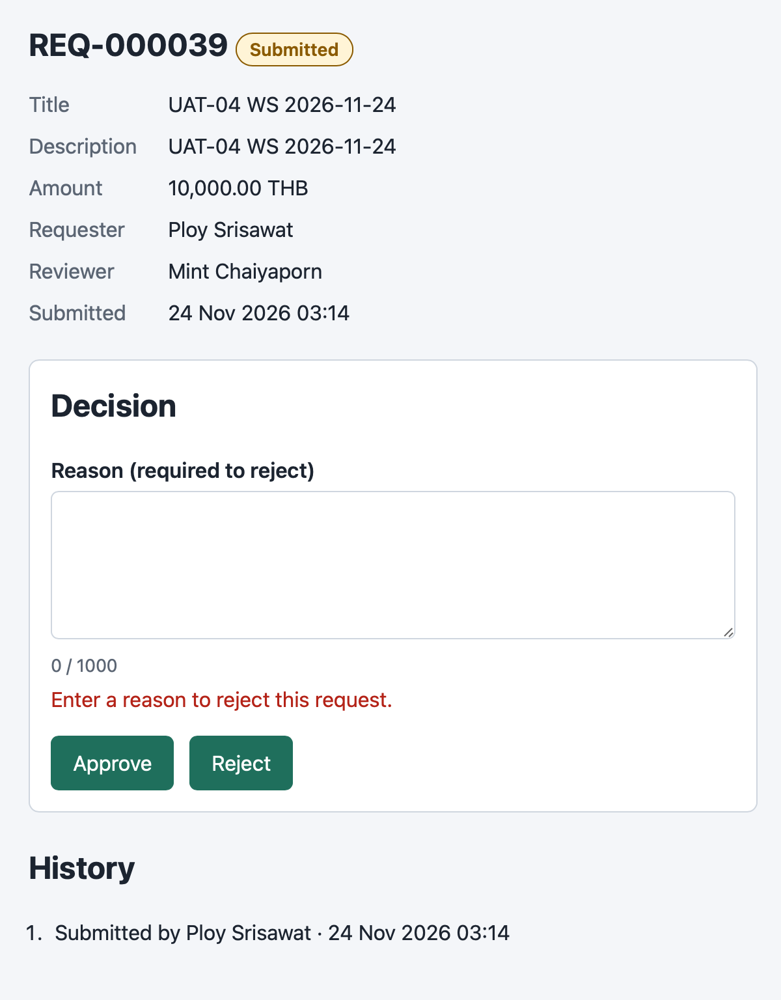

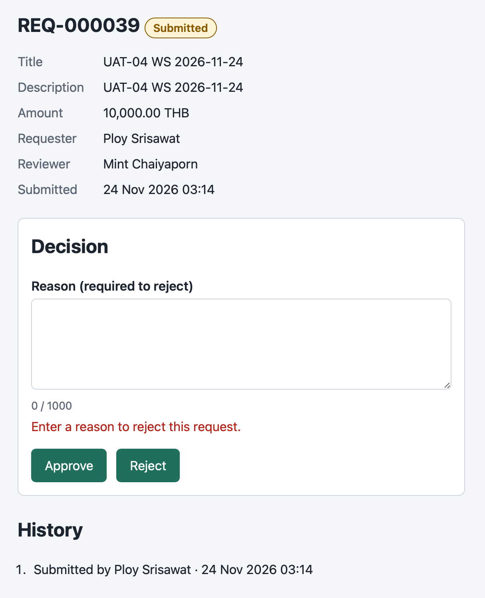

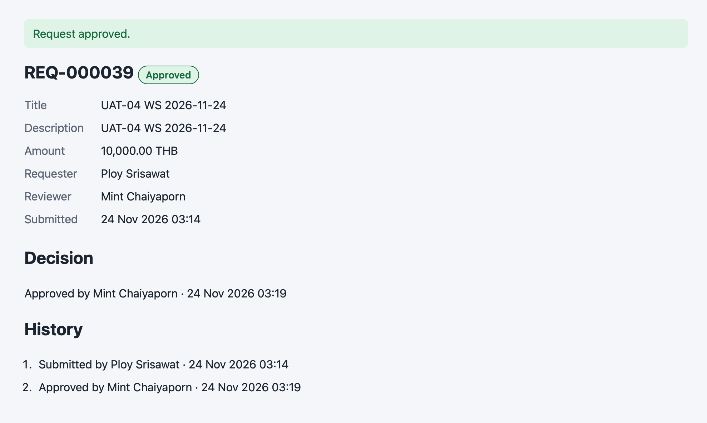

- **Attribution:** The original UAT actions were performed by Codex at Worawut's request. The three additional `REQ-000039` screenshots were supplied by Worawut. Neither set independently establishes participation by both students required by the handout.

## UAT-05 notes

- **Test data:** REQ-A Ploy, reviewer REV-A Mint. Required-field test used blank title and description with amount 10. Title-length test used 121 `A` characters. Boundary acceptance used a 120-character title beginning `UAT-05 WS 2026-11-23`, a 2,000-character description, amount 10, and created `REQ-000023`. Special-character test used title ``, description ``, amount 10, and created `REQ-000024`.
- **Observed:** In the original run, empty values displayed `Enter a title.` and `Enter a description.`; a 121-character title displayed `Title must be 120 characters or fewer.`; a 120-character title and 2,000-character description were accepted as `REQ-000023`; and the script and image payloads appeared as literal text in detail and My Requests, with no alert. The supplied retest screenshots show the empty-field validation, the over-limit title validation, a long-title request accepted as `REQ-000043` with description `limit`, and the two HTML strings displayed literally in `REQ-000044`.
- **Evidence limitation:** The `REQ-000043` retest screenshot supports acceptance of a long title, but its description is `limit`; it does not retest the 2,000-character description boundary. That boundary was observed in the original `REQ-000023` run. The new screenshots are cropped and do not show the Build footer.
- **Build:** Build 21b7135 was visible in the original run on form, submitted detail, and My Requests screens.
- **Evidence:** [E-UAT-05-01](evidence/E-UAT-05-01-required-fields-empty.png) shows both required-field errors; [E-UAT-05-02](evidence/E-UAT-05-02-title-over-limit.png) shows the title length error; [E-UAT-05-03](evidence/E-UAT-05-03-long-title-accepted.png) shows `REQ-000043`; and [E-UAT-05-04](evidence/E-UAT-05-04-html-strings-literal.png) shows the literal strings in `REQ-000044`.

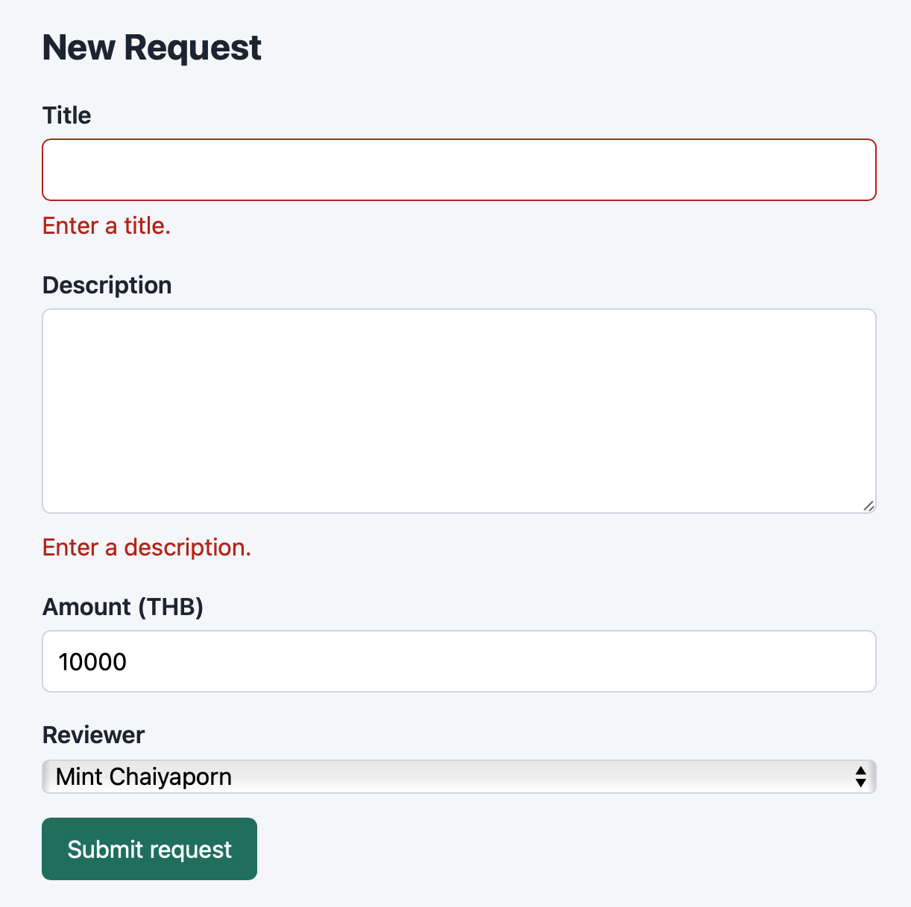

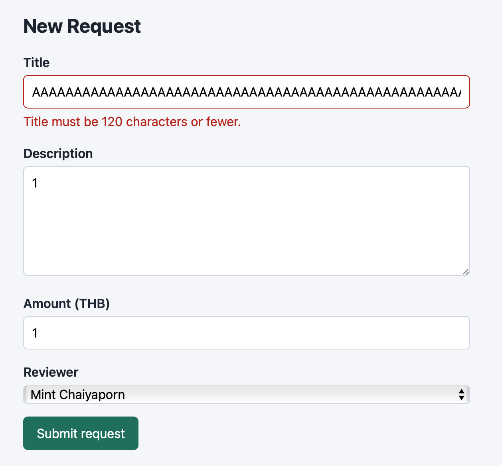

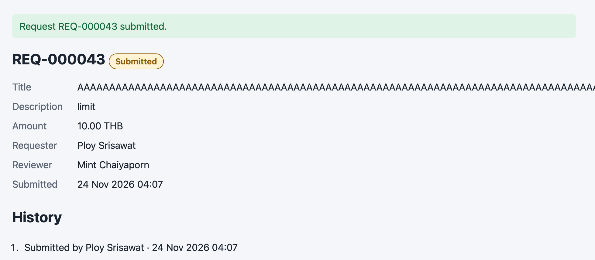

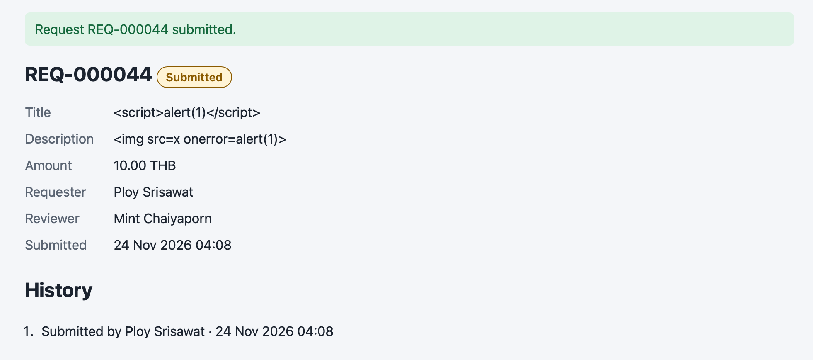

- **Attribution:** The original UAT actions were performed by Codex at Worawut's request. The four additional screenshots were supplied by Worawut. Neither set independently establishes participation by both students required by the handout.

## UAT-06 notes

- **Test data / roles:** REQ-A Ploy, followed by a signed-out browser session.
- **Observed:** [E-UAT-06-07](evidence/E-UAT-06-07-ploy-requester-menu.png) confirms Ploy is signed in as Requester and Review Inbox is absent from the menu. [E-UAT-06-08](evidence/E-UAT-06-08-ploy-reviews-denied.png) confirms direct `/reviews` shows `This page is not available to you.` while Ploy's name and Requester role are visible. The signed-in `GET /api/reviews/inbox` check returned HTTP 403 with body `FORBIDDEN` and no request data; [E-UAT-06-03](evidence/E-UAT-06-03-signed-in-reviews-forbidden.png) and [E-UAT-06-09](evidence/E-UAT-06-09-ploy-reviews-forbidden-body.png) show the denial. After logout, `/requests` showed the Sign in page. [E-UAT-06-10](evidence/E-UAT-06-10-signed-out-requests-401.png) and [E-UAT-06-11](evidence/E-UAT-06-11-signed-out-inbox-401.png) show HTTP 401 with `UNAUTHENTICATED` bodies for the two API routes. A separate E-UAT-06-12 capture was omitted from the public copy because it exposed unrelated browser tabs.
- **Result:** PASS. The menu, page guard, signed-in API denial, signed-out page, and both unauthenticated API responses matched the expected results.
- **Build:** Build 21b7135 was visible on the original denied `/reviews` screen; the API captures do not show the footer.
- **Evidence:** [E-UAT-06-01](evidence/E-UAT-06-01-denied-reviews-page.png) through [E-UAT-06-11](evidence/E-UAT-06-11-signed-out-inbox-401.png), excluding the omitted E-UAT-06-12 capture.
- **Attribution:** The original UAT actions were performed by Codex at Worawut's request. The additional screenshots were supplied by Worawut; the available record does not establish participation by both students required by the handout.

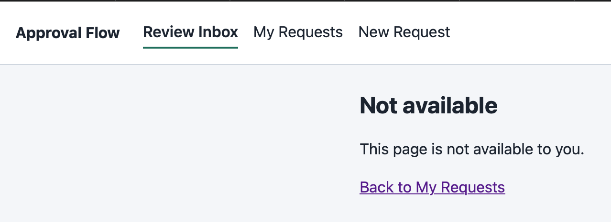

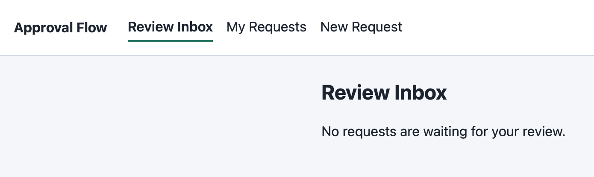

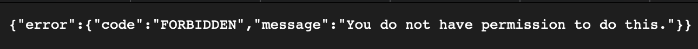

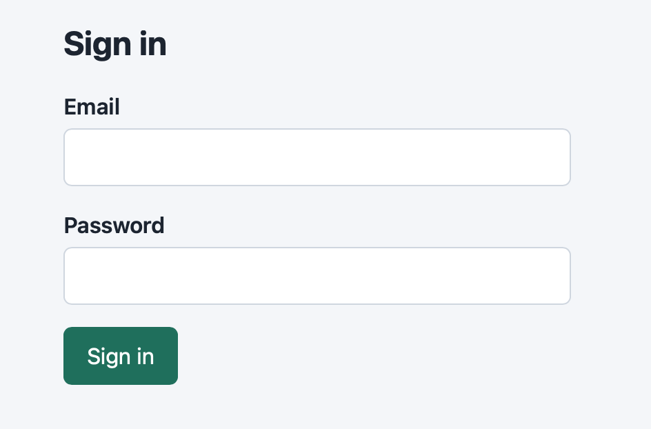

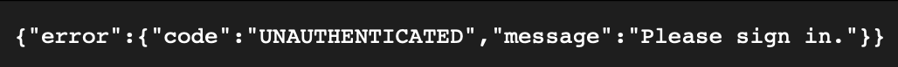

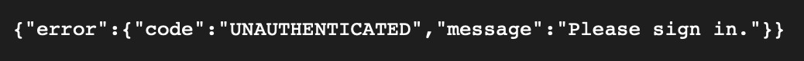

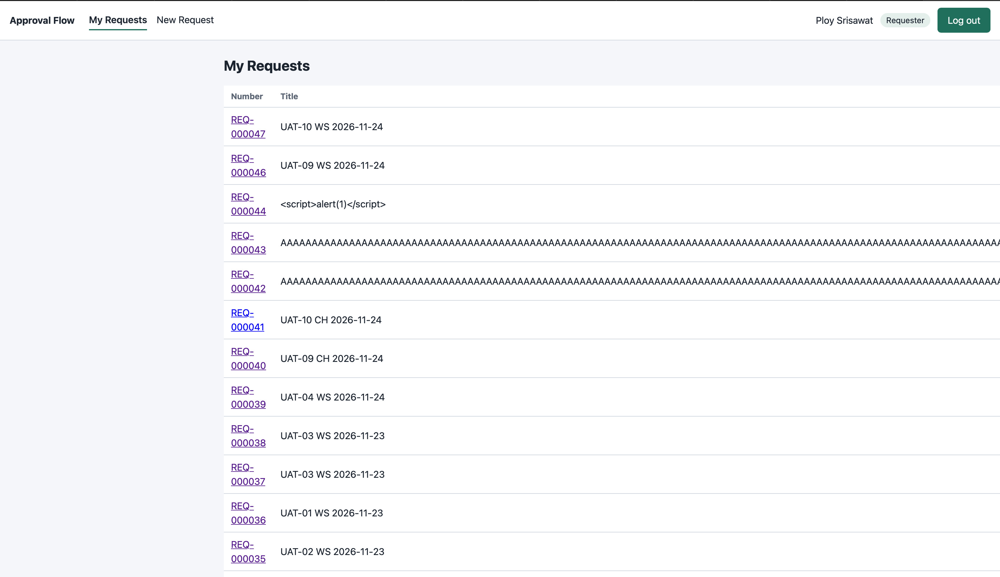

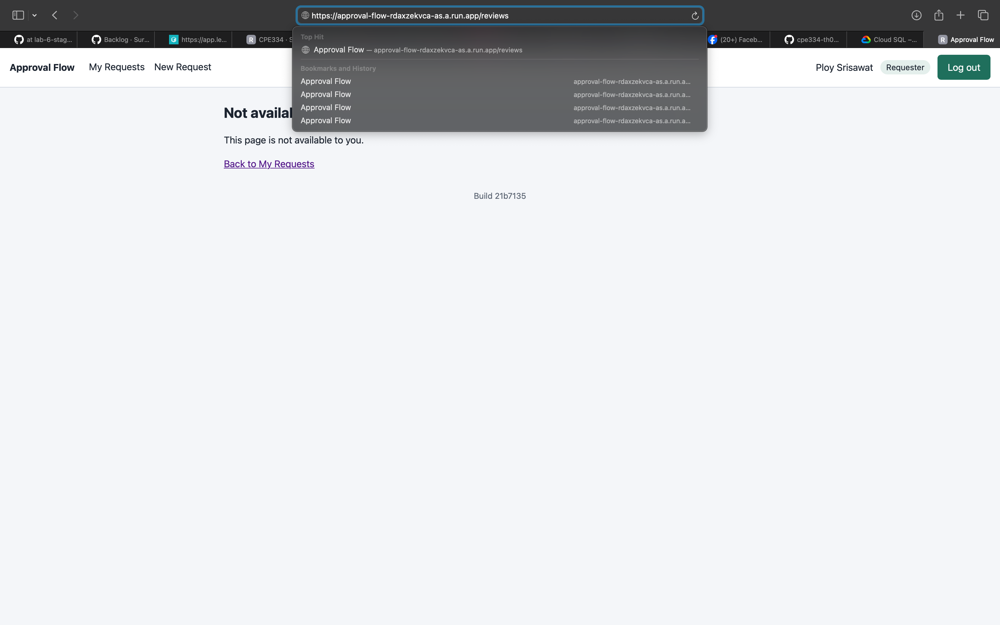

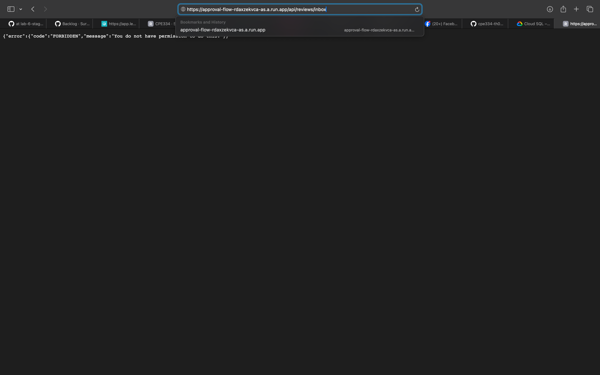

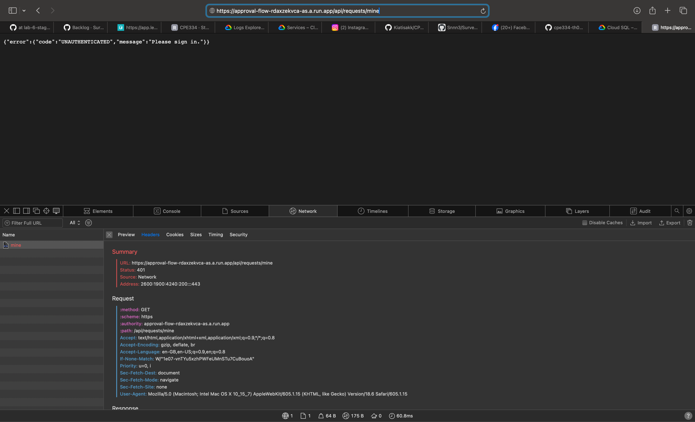

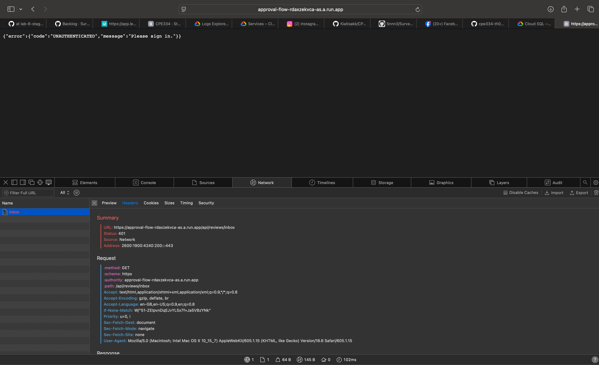

## UAT-07 notes

- **Test data / roles:** Ploy created `REQ-000025` (`UAT-07 WS 2026-11-23`, THB 700, assigned to Mint). REQ-B and REV-B were the unauthorized accounts; REV-A Mint was the assigned reviewer.
- **Original run:** REQ-B did not see `REQ-000025` in My Requests and saw `This request is not available to you.` at `/requests/25`. REV-B did not see it in Review Inbox and saw the same page message. Both `/api/requests/25` responses had the identical `NOT_FOUND` body; Safari Inspector Console showed HTTP 404. Assigned reviewer Mint opened `REQ-000025` and saw its details and decision panel.
- **New screenshots:** The requester and reviewer page captures show `This request is not available to you.`; the two API captures show `NOT_FOUND`. None shows a request ID or an API status. The reviewer page identifies Mint Chaiyaporn, but shows access denied; because the request ID is absent, it cannot be determined whether this is the original `REQ-000025` assigned to Mint. The added captures do not confirm or overturn the initial result.
- **Build:** Build 21b7135 was visible on the assigned reviewer page in the original run. The new screenshots are cropped and do not show the footer.
- **Evidence:** [E-UAT-07-01](evidence/E-UAT-07-01-requester-unavailable-page.png) and [E-UAT-07-02](evidence/E-UAT-07-02-requester-not-found-body.png) show the requester-side denial; [E-UAT-07-03](evidence/E-UAT-07-03-reviewer-unavailable-page.png) and [E-UAT-07-04](evidence/E-UAT-07-04-reviewer-not-found-body.png) show the reviewer-side denial and `NOT_FOUND` body.

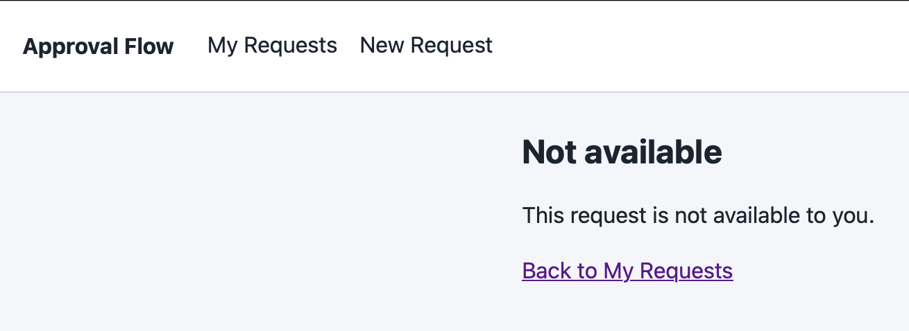

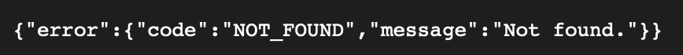

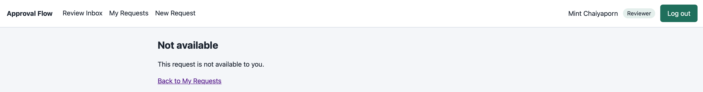

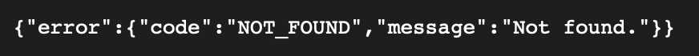

- **Attribution:** The original UI actions were performed by Codex at Worawut's request. The four additional UAT-07 screenshots were supplied by Worawut. Neither set independently establishes participation by both students required by the handout.

## UAT-08 notes

- **Test data:** The original run used `REQ-000026`, `UAT-08 WS 2026-11-23`, THB 500, Mint as requester, and Korn as reviewer. The screenshot retest used title and description `UAT-08 WS 2026-11-24`, THB 500, and created `REQ-000045` with Mint as requester and Korn as reviewer.
- **Observed:** In the original run, Mint was absent from the reviewer choices and Korn was available; `REQ-000026` did not appear in Mint's inbox, and Mint's detail page had no decision panel. Korn's inbox listed the request and its detail showed the decision panel. The new screenshots confirm Mint's dropdown offers Korn only, `REQ-000045` was submitted to Korn, Mint's inbox says no requests are waiting, and Mint's detail for `REQ-000045` has no decision panel.
- **Build:** Build 21b7135 was visible on the original request detail screens. The new screenshots do not show the build footer.
- **Evidence:** [E-UAT-08-01](evidence/E-UAT-08-01-reviewer-dropdown-korn-only.png) shows the reviewer dropdown; [E-UAT-08-02](evidence/E-UAT-08-02-REQ-000045-submitted.png) shows the submission; [E-UAT-08-03](evidence/E-UAT-08-03-mint-inbox-empty.png) shows Mint's empty Review Inbox; and [E-UAT-08-04](evidence/E-UAT-08-04-mint-no-decision-controls.png) shows the request detail without decision controls. [E-UAT-08-SUPP-01](evidence/E-UAT-08-SUPP-01-REQ-000013-korn-review-panel.png) shows Korn's decision panel for earlier `REQ-000013` with a UAT-08 title.

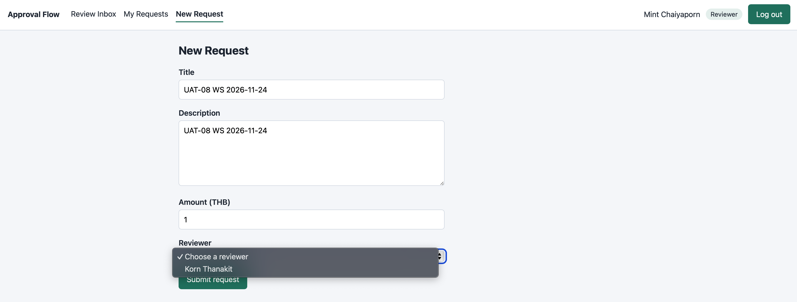

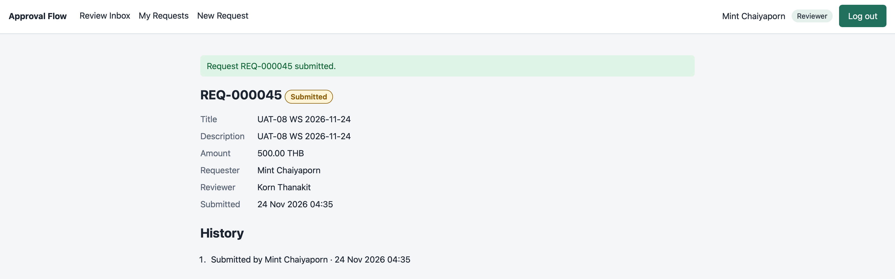

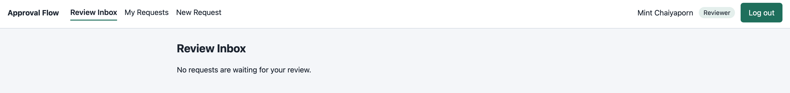

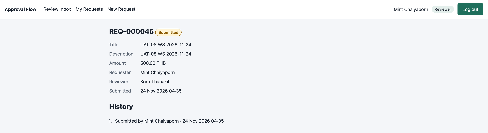

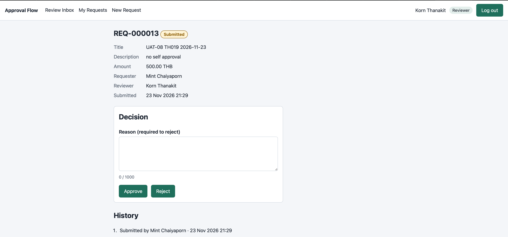

- **Attribution:** The original UI actions were performed by Codex at Worawut's request. The four retest screenshots and the supplemental screenshot were supplied by Worawut; participation by both students was not independently observed.

## UAT-09 notes

- **Test data:** Ploy created `REQ-000029`, `UAT-09 WS 2026-11-23`, THB 900, assigned to Mint. Mint rejected it with `Not in this quarter's budget.`
- **Retest data:** Ploy submitted `REQ-000046`, `UAT-09 WS 2026-11-24`, THB 10,000, assigned to Mint. The screenshot shows submission at 04:48 and rejection at 04:49 on 2026-11-24; the rejection reason is `Bad`.
- **Observed:** The supplied requester detail shows Rejected, Mint as decider, reason `Bad`, and Submitted → Rejected history. It has no edit or delete controls visible. Mint's supplied Review Inbox screenshot says no requests are waiting, but does not display a request ID. The two requester detail screenshots show the same final state and do not independently establish a reload or a second transition. The initial `REQ-000029` run separately verified the persisted state after Ploy signed in again and that it left Mint's inbox.
- **Build:** Build 21b7135 was visible in the original run; the retest screenshots do not show the footer.
- **Evidence:** The three supplied screenshots are [E-UAT-09-01](evidence/E-UAT-09-01-REQ-000046-rejected-detail.png), [E-UAT-09-02](evidence/E-UAT-09-02-REQ-000046-rejected-detail-repeat.png), and [E-UAT-09-03](evidence/E-UAT-09-03-mint-inbox-empty-after-rejection.png). E-UAT-09-04 remains pending for a detail capture after confirmed reload or re-login; the supplied repeated detail captures do not establish persistence for `REQ-000046`.
- **Attribution:** The original UI actions were performed by Codex at Worawut's request; the retest screenshots were supplied by Worawut. Participation by both students was not independently observed.

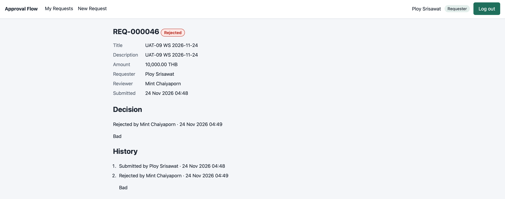

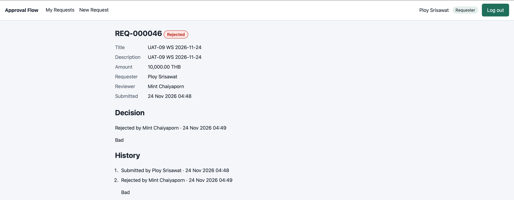

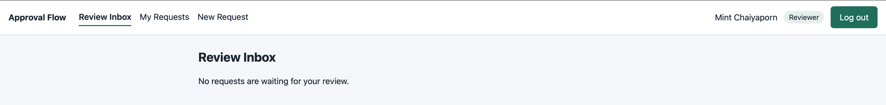

## UAT-10 notes

- **Test data:** Ploy created `REQ-000030`, `UAT-10 WS 2026-11-23`, THB 500, assigned to Mint. Mint opened it in two tabs.
- **Retest data:** Ploy created `REQ-000047`, `UAT-10 WS 2026-11-24`, THB 6,700, assigned to Mint. The supplied screenshots show it submitted at 04:59 and approved at 05:01 with reason `LGTM. Approved`.
- **Observed:** The screenshots show two Mint tabs on the same Submitted request. Approving in the first tab succeeds. The stale second tab then displays `This request has already been decided.` after a rejection attempt, even though its reason field contains the different unsaved text `LGTM. Approved Too`. After refresh, the second tab shows Approved, the saved reason `LGTM. Approved`, and only one decision in history. Ploy's detail independently shows the same Approved status, reason, and Submitted → Approved history.
- **Build:** Build 21b7135 is visible in the retest screenshots.
- **Evidence:** The five supplied screenshots are [E-UAT-10-01](evidence/E-UAT-10-01-REQ-000047-two-tabs-submitted.png), [E-UAT-10-02](evidence/E-UAT-10-02-first-tab-approved.png), [E-UAT-10-03](evidence/E-UAT-10-03-stale-tab-already-decided.png), [E-UAT-10-04](evidence/E-UAT-10-04-stale-tab-refreshed.png), and [E-UAT-10-05](evidence/E-UAT-10-05-requester-approved-detail.png).
- **Attribution:** The original UI actions were performed by Codex at Worawut's request; the retest screenshots were supplied by Worawut. Participation by both students was not independently observed.

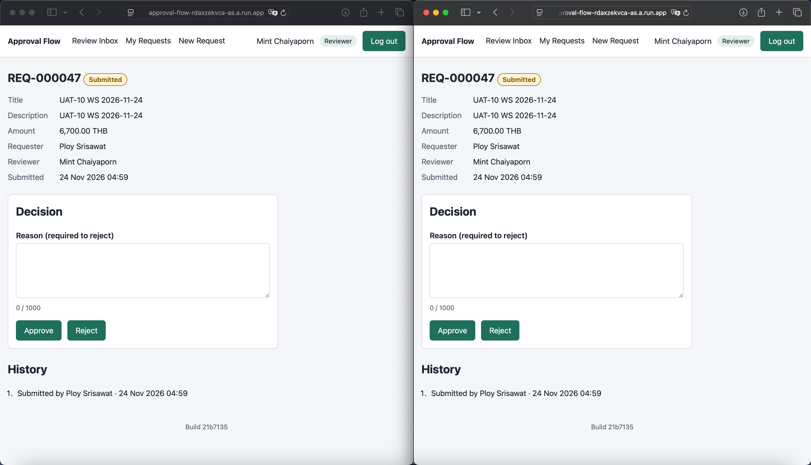

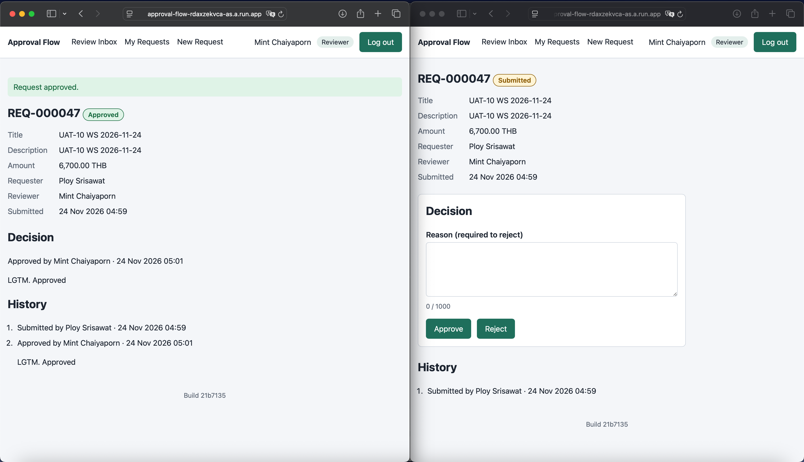

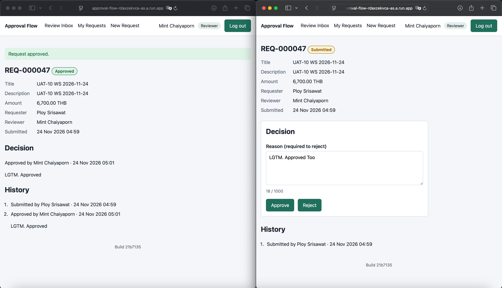

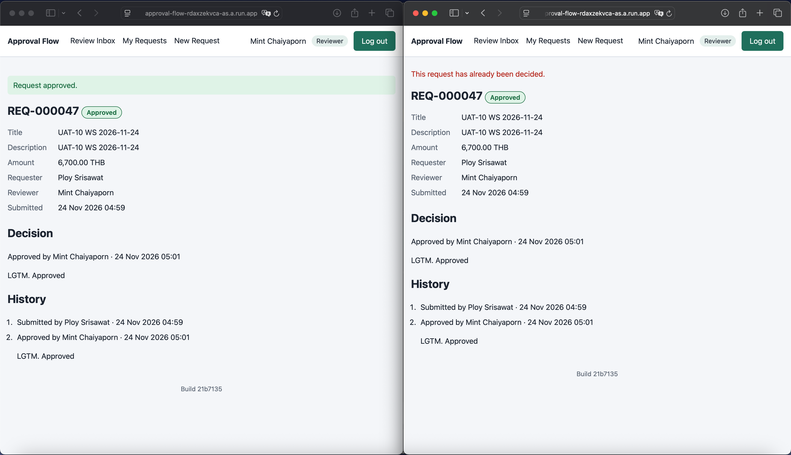

## UAT-11 notes

- **Observed:** Submitting the empty sign-in form showed `Enter your email address.` and `Enter your password.`; this validation was repeated in Safari on 2026-11-24 00:38. The Email field focus indicator was observed, but the related screenshot was omitted because a saved-account autofill prompt was visible. In the initial run, `PLOY.Requester@Example.COM ` with the correct password signed in as Ploy and remained signed in after reload; after logout, `/requests` showed the sign-in page. The supplied case-variant entry screenshot followed by [E-UAT-11-06](evidence/E-UAT-11-06-case-variant-sign-in-success.png) shows Ploy signed in to My Requests after using `PLOY.Requester@Example.COM`; the new screenshots do not show trailing whitespace or a reload. The new known-account and unknown-account screenshots show the same `Email or password is incorrect.` message. The Mint screenshot shows Mint signed in to an empty Review Inbox.
- **Result:** PASS. The empty-form validation and other observed steps matched their expected results.
- **Build:** Build 21b7135 was visible in the initial run; the supplied screenshots do not show the footer.
- **Evidence:** [E-UAT-11-01](evidence/E-UAT-11-01-empty-sign-in-validation.png), [E-UAT-11-02](evidence/E-UAT-11-02-case-variant-credentials-entered.png), [E-UAT-11-03](evidence/E-UAT-11-03-known-account-generic-error.png), [E-UAT-11-04](evidence/E-UAT-11-04-unknown-account-generic-error.png), [E-UAT-11-05](evidence/E-UAT-11-05-mint-review-inbox.png), and [E-UAT-11-06](evidence/E-UAT-11-06-case-variant-sign-in-success.png). E-UAT-11-07 was omitted from the public copy because its autofill prompt showed a saved test account.
- **Attribution:** The initial UI actions were performed by Codex at Worawut's request; the additional screenshots were supplied by Worawut. The available record does not establish individual participation by both students.

## UAT-12 notes

- **Test data:** REQ-B Nattapong; six sequential wrong passwords, followed immediately by the correct shared test password; then REQ-A Ploy.
- **Observed:** In the initial run, attempts 1–5 for REQ-B showed `Email or password is incorrect.`; attempt 6 showed `Too many sign-in attempts. Try again in 15 minutes.`. The correct REQ-B password was still refused with the throttle message. Ploy then landed on My Requests successfully, and REQ-B was not used again during the test. The additional screenshots show Ploy's sign-in page reporting 12 minutes and then 11 minutes remaining in a lockout. Another screenshot shows Nattapong signed in to My Requests as Requester. This is consistent with the other account remaining usable during Ploy's lockout; the screenshots do not show the exact timing of Nattapong's sign-in relative to the countdown.
- **Build:** Build 21b7135 was visible on the initial run's Login and My Requests pages; the new screenshots do not show the footer.
- **Evidence:** The three supplied screenshots are [E-UAT-12-01](evidence/E-UAT-12-01-ploy-throttled-12-minutes.png), [E-UAT-12-02](evidence/E-UAT-12-02-ploy-throttled-11-minutes.png), and [E-UAT-12-03](evidence/E-UAT-12-03-nattapong-my-requests.png).
- **Attribution:** The initial UI actions were performed by Codex at Worawut's request; the additional screenshots were supplied by Worawut. Participation by both named students was not independently observed.

