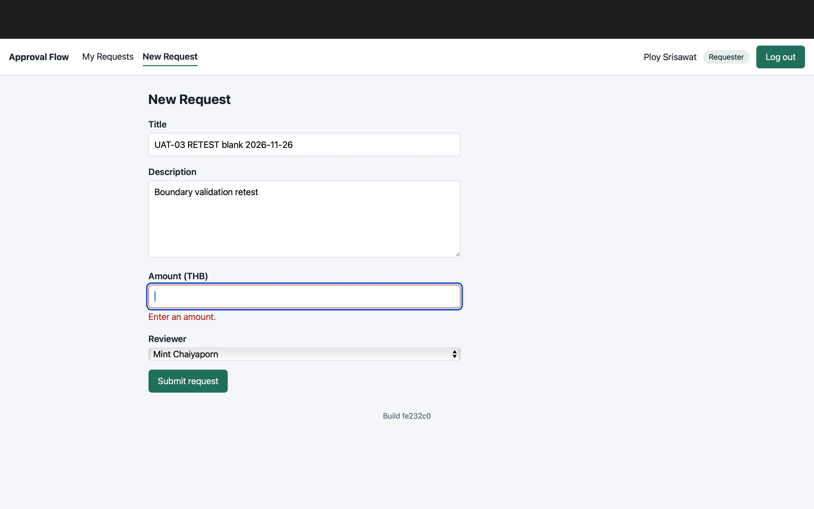
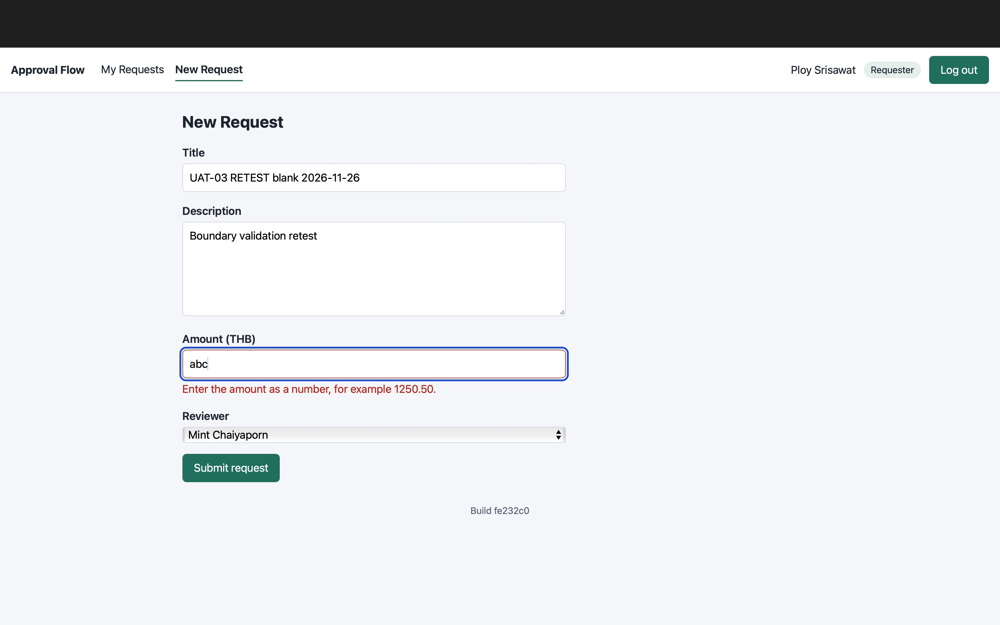
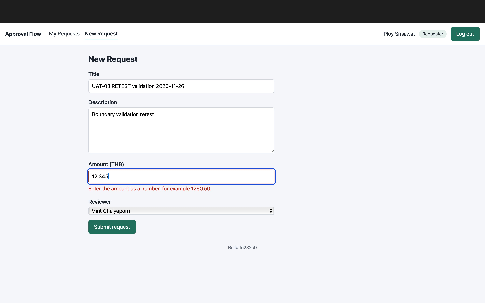
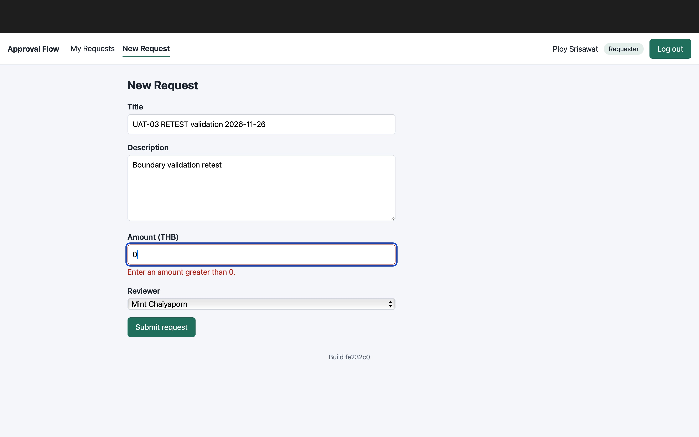
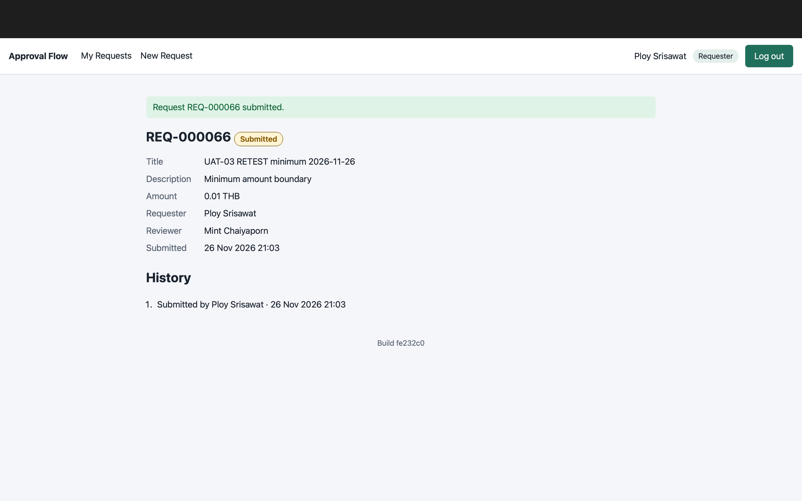
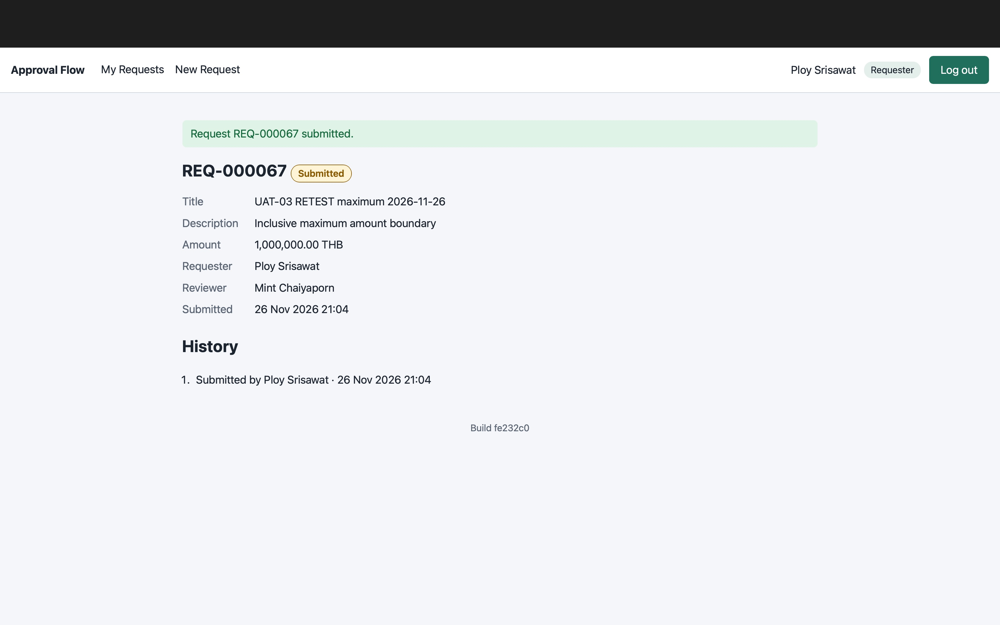

# Lab 6 — UAT Cases retest results: Worawut

## Run information

| Field | Value |
| --- | --- |
| Tester | Worawut (TH-019); execution assisted with computer use |
| Test date | 2026-11-26 (Asia/Bangkok, UTC+07:00) |
| Application URL | <https://approval-flow-rdaxzekvca-as.a.run.app/> |
| Build shown in application | `Build fe232c0` (visible in the app during UAT-03 retest) |
| Revision supplied by TH-044 | `approval-flow-00008-wtx` |
| Commit supplied by TH-044 | `fe232c0893a11116413682222ddc64ef7dbd0a34` |
| Revision / commit verification | Supplied in TH-044's message; not independently exposed by the application UI |
| Scope | UAT-03 amount-boundary defect retest only. |
| Retest window | 2026-11-26, approximately 21:00–21:12 (+07:00) |

UAT-03 was the only known failing case in the UAT exercise and is the only case retested here. No other UAT case was run. The initial URL attempt that returned an error was an access/setup issue, not an application defect or UAT result, and is excluded from the decision. The shared test database was used; requests created below remain in that database.

## Summary

| Case | Expected | Actual | Result | Evidence |
| --- | --- | --- | --- | --- |
| UAT-03 — Amount boundaries | Invalid inputs are rejected with the expected validation; `0.01` and inclusive maximum `1,000,000.00` THB submit successfully. | Each invalid value showed the expected validation. `0.01` submitted as `REQ-000066`; `1,000,000.00` submitted as `REQ-000067` with `Request REQ-000067 submitted.` The app footer showed `Build fe232c0`. | **PASS** | E-RETEST-03-01 to E-RETEST-03-07 |

## UAT-03 — Amount-boundary retest

Tester signed in as requester Ploy and used reviewer Mint. Each input was checked on the New Request form. Invalid entries did not create requests.

| Amount entered | Expected | Actual | Result | Evidence |
| --- | --- | --- | --- | --- |
| Blank | `Enter an amount.` | The amount field displayed `Enter an amount.` | **PASS** | [E-RETEST-03-01](evidence-retest/E-RETEST-03-01-blank-amount.jpg) |
| `abc` | `Enter the amount as a number, for example 1250.50.` | The amount field displayed `Enter the amount as a number, for example 1250.50.` | **PASS** | [E-RETEST-03-02](evidence-retest/E-RETEST-03-02-nonnumeric-amount.jpg) |
| `12.345` | `Enter the amount as a number, for example 1250.50.` | The amount field displayed `Enter the amount as a number, for example 1250.50.` | **PASS** | [E-RETEST-03-03](evidence-retest/E-RETEST-03-03-excess-decimal-places.jpg) |
| `0` | `Enter an amount greater than 0.` | The amount field displayed `Enter an amount greater than 0.` | **PASS** | [E-RETEST-03-04](evidence-retest/E-RETEST-03-04-zero-amount.jpg) |
| `1,000,000.01` | `Enter an amount of at most 1,000,000.00 THB.` | The amount field displayed `Enter an amount of at most 1,000,000.00 THB.` | **PASS** | [E-RETEST-03-05](evidence-retest/E-RETEST-03-05-above-maximum.jpg) |
| `0.01` | Request is submitted. | Success message showed `Request REQ-000066 submitted.` The request was created for THB 0.01. | **PASS** | [E-RETEST-03-06](evidence-retest/E-RETEST-03-06-minimum-accepted.jpg) |
| `1,000,000.00` | Inclusive maximum is accepted and page shows `Request REQ-… submitted.` | Success message showed `Request REQ-000067 submitted.` The request was created for THB 1,000,000.00. | **PASS** | [E-RETEST-03-07](evidence-retest/E-RETEST-03-07-maximum-accepted.jpg) |

### UAT-03 evidence

**Invalid values and validation messages**

**Valid boundary values**

## Final decision

**Accepted** — UAT-03 passed on the application showing `Build fe232c0`; the inclusive maximum of THB 1,000,000.00 was accepted and submitted as `REQ-000067`.

The initial URL error is excluded because the application test could not start at that URL; it is not a failed UAT case or a product defect. This report covers UAT-03 only; it does not represent a retest of the remaining UAT suite. Revision and full commit SHA are recorded from TH-044's handoff and were not independently shown in the application UI. No application source code or diff was inspected.
