# Part D: Three-Sprint Product Development Plan

**System:** SurveyHub — Review, Feedback, and Survey System (Theme 10)
**Course:** CPE 334 Software Engineering, Semester 1/2026
**Deliverable:** Project Deliverable 1 — Part D (5 points)
**Document status:** Baseline v4, aligned with team decisions on 5 November 2026
**Related documents:** Part A (scope), Part B (features), Part C (design), Part F (verification)

> Status note: this plan starts from the actual situation on 5 November 2026: the engineering
> baseline exists as documents, but the application has not been implemented. The previous draft
> assumed work started on 4 November and presented future work as complete. That is corrected here.

---

## 1. Product Vision and Sprint Allocation

SurveyHub must be a complete survey product by 13 December 2026: owners create and publish surveys,
eligible respondents submit validated answers, owners read trustworthy aggregates, and later sprints
add anonymous mode, richer question types, eligibility control, export and raw-response browsing.

```mermaid
flowchart LR
    subgraph S1["Sprint 1 — Vertical slice (8 Nov)"]
        F01["F-01 Auth & RBAC"]
        F02["F-02 Survey lifecycle"]
        F03["F-03 Response rules"]
        F04["F-04 Aggregate summary"]
    end

    subgraph S2["Sprint 2 — Core expansion (29 Nov)"]
        F05["F-05 Anonymous mode"]
        F06["F-06 Seven additional question types"]
        F07["F-07 Eligibility & scheduled close"]
        L5["Lab 5 — CI/CD, GCP"]
        L6["Lab 6 — Cross-team UAT"]
    end

    subgraph S3["Sprint 3 — Completion (13 Dec)"]
        F08["F-08 Analytics, response browser & export"]
        H["Hardening, defects, regression"]
        V["Final report & 4-minute video"]
        L7["Lab 7 — Maintenance change"]
    end

    S1 --> S2 --> S3
```



---

## 2. Sprint Matrix

| Sprint | Dates | Goal | Features | Requirements | Completion outcome |
|---|---|---|---|---|---|
| **Sprint 1** | 5–8 Nov 2026 | Working vertical slice through UI, API and database with authentication, ownership and tested rules | F-01, F-02, F-03, F-04 | FR-01..FR-10; BR-01..BR-09; BR-11 (aggregate privacy portion); NFR-SEC-01..04, NFR-PERF-01, NFR-DATA-01 | Feature PRs merged to `sprint-1-staging`; approved release PR to `main`, tag `v0.1.0-sprint1`, tests and demo evidence, D1 PDF |
| **Sprint 2** | 9–29 Nov 2026 | Complete the core product: anonymous mode, advanced question types, eligibility, deployment and independent UAT | F-05, F-06 ([Issue #9](https://github.com/Snnn3/SurveyHub/issues/9)), F-07 | FR-11, FR-12, FR-14, FR-15; BR-02 (scheduled close), BR-08 (allowlist), BR-10, NFR-PRIV-01 | Deployed integrated release candidate on GCP; D2; Lab 5 and Lab 6 complete |
| **Sprint 3** | 30 Nov–13 Dec 2026 | Finish analytics/export, harden, fix defects and release the complete product | F-08 plus hardening | FR-13, FR-16; BR-11 (raw/export policy) | Final release, Lab 7 change, final report and video |

### 2.1 Schedule constraints

- Deliverable 1 is due **8 November 2026 at 23:59**.
- The final examination period is **1–11 December 2026**. The product should be substantially complete
  by 29 November; December is for verification, defects and submission.
- Labs 5, 6 and 7 run in parallel with the project and consume team time. The plan assumes one to two
  working days per lab outside Sprint 1.
- Sprint 1 is deliberately narrow. Adding anonymous mode, export or advanced question types before
  8 November would put the whole deliverable at risk.

---

## 3. Sprint 1 Scope

### 3.1 In scope

| Feature | Included behaviour |
|---|---|
| F-01 Auth & RBAC | Login, `/me`, logout with `tokenVersion` revocation, bcrypt cost 10, role guard, 401/403 errors |
| F-02 Survey lifecycle | List own surveys, create draft, get detail, replace draft questions, delete draft, publish, close, ownership and immutability guards |
| F-03 Response rules | Browse published surveys, load form, submit one response, persisted receipt, duplicate guard, state guard, required/type/option validation, cross-response privacy |
| F-04 Aggregate summary | Total responses, answered count per question, option counts and percentages, unlinked text answers, owner-only access, empty state |
| E2E | One normal journey and one rejection journey |

### 3.2 Out of scope for Sprint 1

- Anonymous mode (F-05) — Sprint 2.
- Multi-choice, long text, yes/no, Likert, rating, integer and date (F-06) — Sprint 2.
- Eligibility allowlist management and scheduled close (F-07) — Sprint 2.
- CSV/JSON export, charts, raw-response browser (F-08) — Sprint 3.
- CI/CD and GCP deployment — Lab 5, after D1. Docker Compose local setup is included in Sprint 1 Issue [#2](https://github.com/Snnn3/SurveyHub/issues/2).
- Self-registration, password reset, email invitations — excluded.

### 3.3 Sprint 1 completion criteria

- All Sprint 1 acceptance criteria in Part E are implemented and verified, or explicitly disclosed as
  incomplete.
- The full test command runs on the release commit and counts are recorded.
- The normal journey, a rule rejection, a forbidden operation and logout are demonstrated with real
  evidence.
- The release is on `main`, tagged, and reproducible from the README.
- Part F contains no invented results.

---

## 4. Dependencies and Critical Path

### 4.1 Feature dependencies

| Feature | Depends on | Reason |
|---|---|---|
| F-01 | None | Identity and role are the foundation for every protected operation |
| F-02 | F-01 | Only an authenticated owner can manage surveys |
| F-03 | F-01, F-02 | A published survey must exist before a response can be submitted |
| F-04 | F-01, F-02, F-03 | Summary needs stored responses |
| F-05 | F-01, F-03, F-04 | Anonymous mode changes response storage and summary output |
| F-06 | F-02, F-03, F-04 | Authoring, submission and summary must all understand the new types |
| F-07 | F-02, F-03 | Eligibility and scheduled close modify publish and submit rules |
| F-08 | F-04, F-06 | Export and charts depend on summary data and question types |

### 4.2 Critical path for Sprint 1

```text
Scaffold + schema + seed
        ↓
F-01 auth and roles
        ↓
F-02 survey lifecycle ──→ F-03 responses ──→ F-04 summary
        ↓                       ↓                  ↓
        └──────────── integration tests ───────────┘
                                ↓
                    E2E, evidence, release tag, D1 PDF
```

The critical path is **schema → auth → lifecycle → responses → verification**. A delay in the schema
delays everything, so the schema and migration are completed before UI work.

### 4.3 Team allocation (avoiding permanent silos)

Both students must participate in requirements, design, implementation, testing, review and release.
The split below is by feature lead, not by permanent layer ownership.

| Work | Primary author | Reviewer | Both contribute |
|---|---|---|---|
| Issues and contracts review | Both | Both | Review comments on Parts A–E |
| GitHub Issue [#2](https://github.com/Snnn3/SurveyHub/issues/2): scaffold, schema, migration, seed and Docker Compose | Worawut | Chanon | Chanon verifies seed, test DB and Compose persistence |
| F-01 Auth & RBAC | Worawut | Chanon | Chanon writes two security tests |
| F-02 Survey lifecycle | Chanon | Worawut | Worawut writes structure/ownership tests |
| F-03 Response rules | Worawut | Chanon | Chanon writes duplicate and privacy tests |
| F-04 Aggregate summary | Chanon | Worawut | Worawut writes percentage and access tests |
| F-01..F-04 UI | Chanon | Worawut | Worawut reviews API integration |
| E2E and release | Both | Both | Pair execution of demo scenarios |
| D1 PDF and evidence | Both | Both | Page compilation and checklist |

The contribution table in Part F records actual work, not this plan.

---

### 4.4 Sprint 1 issue map

| Issue | Work | Feature/contract |
|---|---|---|
| [#1](https://github.com/Snnn3/SurveyHub/issues/1) | Scope, requirements, feature inventory, design and Sprint 1 contracts | Parts A–E |
| [#2](https://github.com/Snnn3/SurveyHub/issues/2) | Application/database scaffold, migrations, seed and Docker Compose | Foundation |
| [#3](https://github.com/Snnn3/SurveyHub/issues/3) | Authentication, sessions and RBAC | F-01 |
| [#4](https://github.com/Snnn3/SurveyHub/issues/4) | Survey lifecycle and authoring | F-02 |
| [#5](https://github.com/Snnn3/SurveyHub/issues/5) | Survey response submission and business rules | F-03 |
| [#6](https://github.com/Snnn3/SurveyHub/issues/6) | Owner aggregate summary | F-04 |
| [#7](https://github.com/Snnn3/SurveyHub/issues/7) | Integration, verification evidence, release and deliverable | Part F and release |

## 5. Risk Register

| # | Risk | Probability | Impact | Mitigation | Owner |
|---|---|---|---|---|---|
| 1 | **Schedule:** implementation starts on 5 Nov with D1 due 8 Nov | High | High | Freeze Sprint 1 scope; build the vertical slice first; no optional UI polish before tests and release | Both |
| 2 | **Fabricated evidence:** documents claim tests/PRs/screenshots that do not exist | High if not corrected | High | Part F is a verification plan until real runs; every result must include command, commit and output; no placeholder is submitted as PASS | Both |
| 3 | **Schema rework in Sprint 2:** expanded answer types or anonymous mode break the model | Medium | High | Define typed storage now: `AnswerOption`, `textValue`, `numberValue`, `dateValue`, numeric bounds, `SurveyEligibility`, `ResponseClaim`, nullable respondent | Worawut |
| 4 | **Anonymous privacy overclaim:** identity can be correlated | Medium | High | Separate claim and response; no metadata; document residual risk; test `respondent_id IS NULL` and response shape | Both |
| 5 | **Authorization bypass:** UI-only restrictions | Medium | High | Backend role/ownership guards; API tests for every forbidden operation; never trust hidden controls | Worawut |
| 6 | **Duplicate race condition:** two simultaneous submissions | Medium | Medium | Service pre-check + unique claim constraint + `P2002` mapping; concurrency test | Worawut |
| 7 | **GCP/CI access delayed in Lab 5** | Medium | High | Keep local Docker reproducible; design env-based config; do not couple Sprint 1 to cloud | Both |
| 8 | **Test database drift or flaky tests** | Medium | Medium | Separate `surveyhub_test`, `jest --runInBand`, deterministic truncation and fixtures | Chanon |
| 9 | **Exam-period availability (1–11 Dec)** | High | Medium | Substantially complete by 29 Nov; December reserved for verification and defects | Both |
| 10 | **Team knowledge silo** | Medium | High | Cross-review every PR; each student writes tests for the other's feature; both explain a sampled requirement in the video | Both |

---

## 6. Milestones and Checkpoints

| Date | Milestone | Evidence |
|---|---|---|
| 5 Nov | Scope and contracts prepared for teammate review; scaffold starts after Issue #1 is accepted | Issue [#1](https://github.com/Snnn3/SurveyHub/issues/1) review record; Issue [#2](https://github.com/Snnn3/SurveyHub/issues/2) is next |
| 6 Nov | F-01 and F-02 working with tests | PRs into `sprint-1-staging`; test output |
| 7 Nov | F-03 and F-04 working; integration/E2E run | Full suite output; TDD red/green logs |
| 8 Nov | `v0.1.0-sprint1` on `main`; D1 PDF submitted | Tag, release PR, PDF, screenshots |
| 15 Nov | Lab 5 CI/CD and GCP deployment | Deployment URL and CI run; Docker Compose evidence is captured in Sprint 1 |
| 22 Nov | Lab 6 cross-team UAT and defect fixes | UAT records, defect register |
| 29 Nov | Sprint 2 complete; D2 submitted | Deployed candidate, contracts, traceability, metrics |
| 30 Nov–13 Dec | Sprint 3: Lab 7 maintenance change, F-08, hardening and final release | Lab 7 change, charts/export evidence, regression results |
| 1–11 Dec | Final examination period | Bounded defect and verification work only |
| 13 Dec | Final product, report and video | Final tag, complete PDF, video link |

---

## 7. Change Control and Shared Kanban Workflow

- A change to scope, a requirement, an acceptance criterion or a contract is recorded with an ID, reason, impact and affected documents before implementation. A required baseline feature is not moved to a later sprint silently; update Part A §3.4, Part B and the linked GitHub issue.
- Team-authored specifications, contracts and evidence are versioned under `docs/`, outside the ignored local-reference folder `docs/materials/`. Review and merge document changes through the same issue and PR workflow as implementation work.
- Use the shared [SurveyHub Kanban project](https://github.com/users/Snnn3/projects/4) across **all sprints**. Sprint labels and filtered views focus work on one sprint; the board itself is not reset for each sprint. Keep Backlog unlimited. Respect WIP limits of 3 in `In progress` and 5 in `In review`.
- For feature work, branch from the current sprint staging branch (`sprint-1-staging` in Sprint 1) and use `feature/<issue-number>-<slug>`. Move the issue to `In progress` after dependencies are complete. Analyze the issue and linked contract, then record a plan and one verification step for each acceptance criterion before implementation. Update the versioned contract before changing behavior.
- Implement the scoped change, run the planned tests and self-review the diff. Open a PR into sprint staging with the issue linked and real check results; move the card to `In review`. A failed required check or requested change moves the same issue and PR to `Fixing`. Fix the same branch, rerun checks, then return it to `In review`. Merge only after a teammate approves and required checks pass. Close the feature issue and move it to `Done` after acceptance criteria are verified.
- Before release, run build, regression and end-to-end checks on sprint staging. Open an approved release PR from staging to `main`; never merge feature work directly to `main`. If release review finds a problem, move the release card to `Fixing`, land corrections in staging through reviewed fix PRs, rerun checks and return the existing release PR to review. Verify the merged commit, tag it `v0.1.0-sprint1`, and move the release issue to `Done` when submission evidence is ready.

---

## 8. Definition of Success by Sprint

| Sprint | Success means |
|---|---|
| Sprint 1 | A local, reproducible vertical slice that enforces its rules and access boundaries, with real test evidence and a tagged release |
| Sprint 2 | The complete core product deployed on GCP, anonymous mode proven with a database audit, advanced question types working, UAT findings handled |
| Sprint 3 | Complete baseline, honest traceability, stable regression suite, no critical defects, final report and video accepted |
